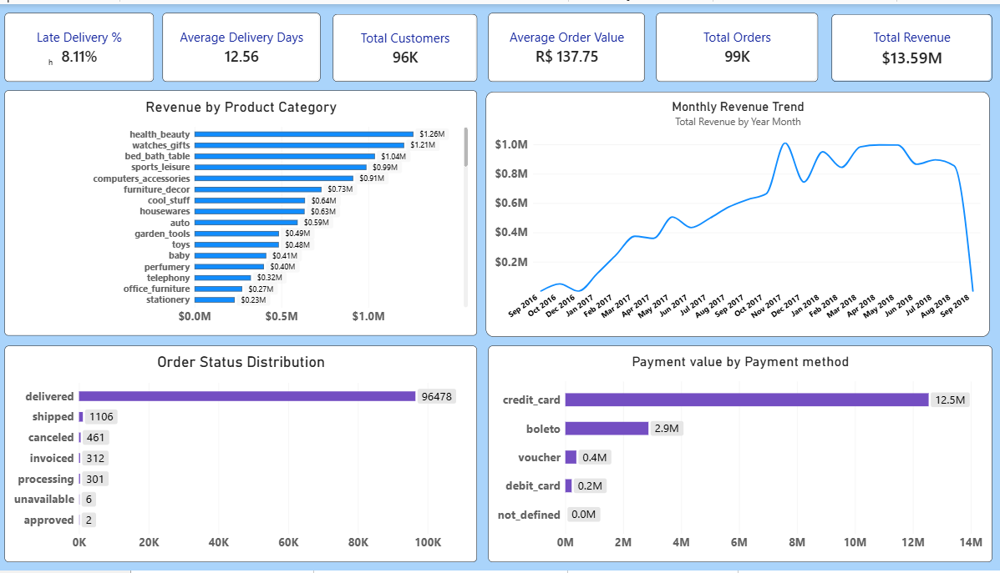
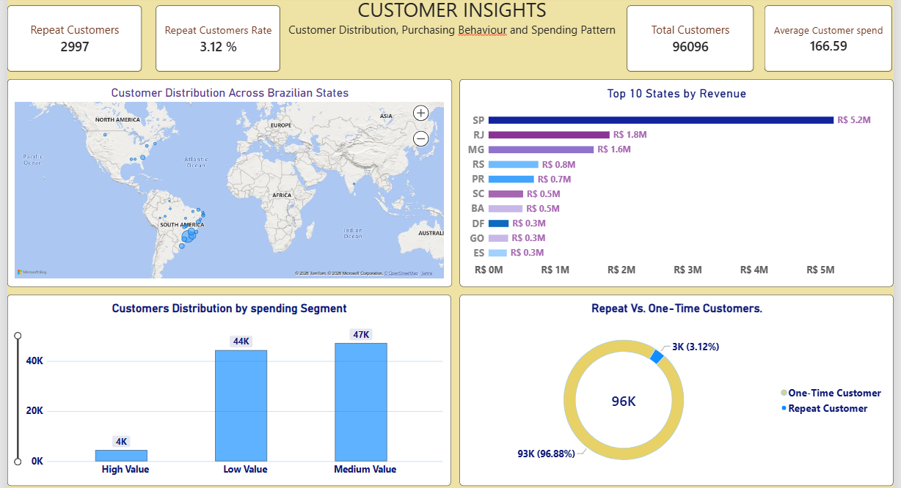
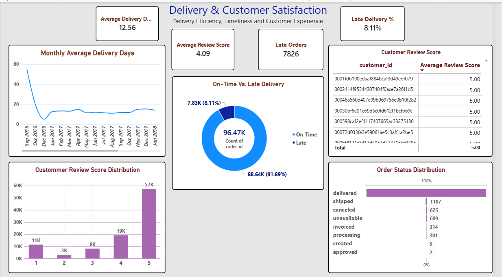
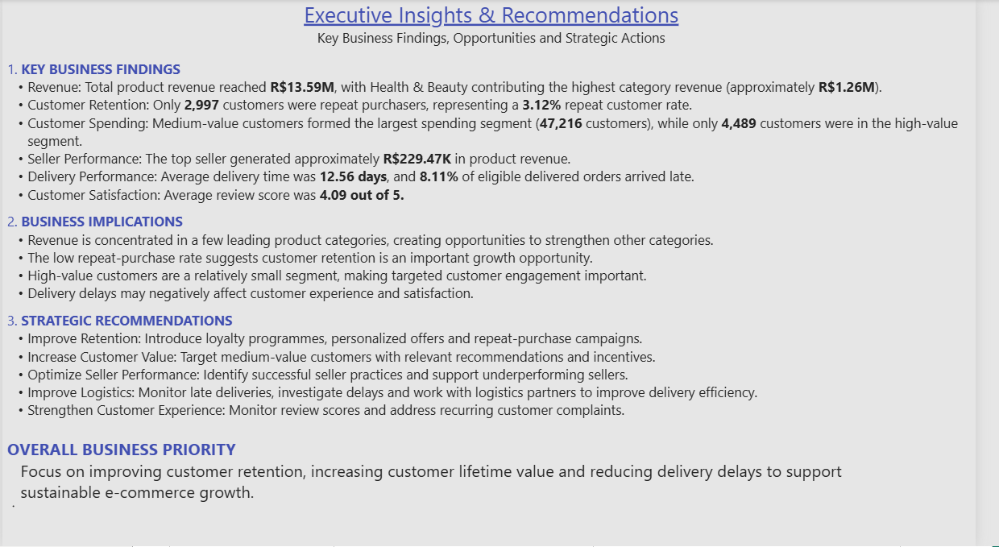

# Olist E-Commerce Analytics Dashboard

An end-to-end e-commerce analytics project built with **PostgreSQL, SQL,
and Microsoft Power BI** using the Olist Brazilian E-Commerce Public
Dataset.

The project explores sales performance, seller contribution, customer
purchasing behaviour, delivery efficiency, and customer satisfaction. It
combines SQL-based data validation and business analysis with an
interactive, multi-page Power BI dashboard.

## Project overview

**Objective:** Turn raw e-commerce data into useful business insights
and practical recommendations.

**Tools used** - PostgreSQL --- relational data storage, data
validation, joins, aggregations, CTEs, window functions, and business
analysis - pgAdmin --- database management and SQL query execution -
Power BI Desktop --- data modelling, DAX measures, interactive visuals,
and dashboard design

## Dashboard pages

1.  **Executive Overview** --- headline KPIs, revenue by product
    category, monthly revenue trend, order status, and payment value by
    payment method.
2.  **Seller Performance** --- seller revenue, order volume, top
    sellers, and average order-item price.
3.  **Customer Insights** --- customer distribution by state, revenue by
    state, spending segments, and repeat versus one-time customers.
4.  **Delivery & Customer Satisfaction** --- average delivery time,
    late-delivery rate, on-time versus late orders, review-score
    distribution, and order status distribution.
5.  **Executive Insights & Recommendations** --- key findings, business
    implications, strategic recommendations, and overall business
    priority.

## Key findings

The following figures are from the completed analysis and dashboard.
Monetary values are in Brazilian reais (R\$).

  -----------------------------------------------------------------------
  Area                                Finding
  ----------------------------------- -----------------------------------
  Product revenue                     Approximately **R\$13.59 million**
                                      in item revenue

  Leading product category            **Health & Beauty**, approximately
                                      **R\$1.26 million**

  Customer base                       **96,096** unique customers

  Repeat customers                    **2,997**, approximately **3.12%**
                                      of unique customers

  Customer spending                   Medium-value segment: **47,216**
                                      customers; high-value segment:
                                      **4,489** customers

  Seller performance                  Top seller generated approximately
                                      **R\$229.47K** in item revenue

  Delivery                            Average delivery time: **12.56
                                      days**

  Late delivery                       **7,826** late orders, or **8.11%**
                                      of eligible delivered orders

  Customer satisfaction               Average review score: **4.09 out of
                                      5**
  -----------------------------------------------------------------------

## Business implications

-   Revenue is concentrated among leading product categories, creating
    an opportunity to develop other categories.
-   The relatively small repeat-customer share indicates an opportunity
    to improve customer retention.
-   The medium-value customer segment is the largest group and may be a
    useful audience for targeted campaigns.
-   Delivery delays should be monitored because they may affect customer
    experience and satisfaction.
-   Seller-level performance comparisons can help identify strong
    practices and sellers that may need support.

## Strategic recommendations

-   Improve retention through loyalty initiatives, personalized offers,
    and repeat-purchase campaigns.
-   Target medium-value customers with relevant product recommendations
    and incentives.
-   Study high-performing sellers and share effective practices across
    the seller base.
-   Monitor late deliveries, investigate recurring causes, and work with
    logistics partners to improve delivery efficiency.
-   Review customer feedback regularly and investigate recurring
    complaints.

## Data model and analysis

The PostgreSQL database uses the `olist` schema and includes tables for
customers, orders, order items, payments, reviews, products, sellers,
and product-category translation.

The analysis includes data quality checks and relationship validation,
revenue and order analysis, category and seller performance, customer
segmentation and repeat-purchase analysis, delivery-time and
late-delivery analysis, and review-score and payment-method analysis.

In the dashboard, **Total Revenue** refers to the sum of product item
prices and excludes freight. Customer payment-value measures use payment
records and may include freight and other order charges. These metrics
therefore represent different business concepts.

## Important analytical notes

-   The repeat-customer rate is based on distinct `customer_unique_id`
    values and customers with more than one order.
-   The late-delivery rate uses delivered orders with both actual
    customer-delivery and estimated-delivery timestamps available as its
    denominator.
-   Spending-segment thresholds (Low: below R\$100; Medium: R\$100 to
    below R\$500; High: R\$500 and above) are analytical groupings used
    in this project, not official Olist customer classifications.
-   The first month in the monthly delivery-time chart has very few
    observations. Interpret that early point cautiously; monthly
    averages can be affected by small sample sizes.
-   Review scores and delivery performance show associations in this
    dataset; the analysis does not establish causation.

## Repository contents

This repository is intended to contain: -
`Olist_Ecommerce_Analytics.pbix` --- Power BI report file - `README.md`
--- project documentation - `Screenshots/` --- selected images of the
five dashboard pages

SQL scripts and the separate SQL analysis repository are maintained
independently.

## Dataset source and attribution

Dataset: [Olist Brazilian E-Commerce Public Dataset on
Kaggle](https://www.kaggle.com/datasets/olistbr/brazilian-ecommerce)

The dataset was made available by **Olist**. Refer to the dataset's
Kaggle page for its terms and **CC BY-NC-SA 4.0** license. Credit the
original source and observe the license conditions, including the
non-commercial and share-alike requirements.

The raw dataset is not included in this repository.

## Dashboard Screenshots

### 1. Executive Overview

### 2. Seller Performance

### 3. Customer Insights

### 4. Delivery & Customer Satisfaction

### 5. Executive Insights & Recommendations

## Author

**payal-dataanalytics**

This project is part of a data analytics portfolio demonstrating SQL
analysis, data modelling, DAX, dashboard development, and business
communication.
## Power BI Dashboard

[Download Interactive Power BI Dashboard](https://1drv.ms/u/c/249e9b503aceb073/IQCfAnwjPj2HTJgjhpJPzv_iAXBEna5Bw9AaFpeqC9B87ms?e=ISj7Vq)

Note: Download the PBIX file and open it using Power BI Desktop to explore the interactive reports.
